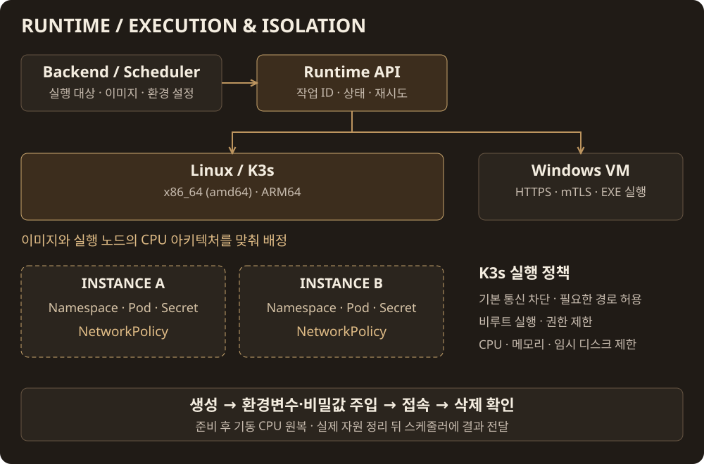

<h1>MSG CTF · Runtime</h1>

문제 실행 · K3s 격리 · 비밀값 주입

<a href="https://msg-ctf.github.io/platform.html">플랫폼</a> · <a href="#development">개발 문서</a>

<h2 align="center">Overview</h2>

| 실행 대상 | 구성 |
| --- | --- |
| **Linux x86_64 · ARM64** | 이미지와 노드 아키텍처를 맞춘 K3s 실행 |
| **Dedicated VM** | 별도 네트워크·권한이 필요한 문제의 전용 VM 실행 |
| **Windows** | Windows VM의 HTTPS executor로 EXE 전달·실행·결과 회수 |

| K3s 격리 | 적용 내용 |
| --- | --- |
| **Namespace · NetworkPolicy** | 인스턴스별 공간 분리, 기본 통신 차단 후 DNS·공개 포트·승인된 내부 경로 허용 |
| **SecurityContext · Resources** | 비루트·권한 제한, CPU·메모리·임시 디스크 제한 |
| **Secret · Lifecycle** | 컨테이너별 비밀값 주입, 기동 CPU 원복, 생성 실패·종료 후 실제 자원 정리 |

Windows는 K3s 컨테이너와 별도 경로이며, 실행 뒤 VM 초기화는 브로커가 담당합니다

[K3s 격리 구현](internal/k3s/security_resources.go) · [네트워크 정책](internal/k3s/network_policies.go) · [Windows 실행](docs/windows-executor.md)

<h2 align="center">Contributors</h2>

<table align="center">
<tr><th align="center" colspan="6"><a href="https://github.com/MSG-CTF/secure-provisioner/tree/dev">Runtime</a></th><th align="center" colspan="6"><a href="https://github.com/MSG-CTF">PM</a></th></tr>
<tr>
<td align="center" valign="top" colspan="6" width="390"> <a href="https://github.com/goldsimchoi"><b>goldsimchoi</b></a> Runtime API · K3s 격리 Gateway · Windows 실행</td>
<td align="center" valign="top" colspan="6" width="390"> <a href="https://github.com/jongcoding"><b>jongcoding</b></a> 운영 QA·기동·삭제 개선 KOTH 저장·복구</td>
</tr>
<tr><th align="center" colspan="6"><a href="https://github.com/MSG-CTF/resource-broker">Resource Broker</a></th><th align="center" colspan="6"><a href="https://github.com/MSG-CTF/msg-backend">Backend</a></th></tr>
<tr>
<td align="center" valign="top" colspan="6" width="390"> <a href="https://github.com/gonas0919"><b>gonas0919</b></a> Windows 실행기 mTLS 설정 연결</td>
<td align="center" valign="top" colspan="6" width="390"> <a href="https://github.com/dnehdx"><b>dnehdx</b></a> RE:QR 이미지 실행 정책 수정</td>
</tr>
</table>

기여 기록 · 관련 PR

| 기여자 | 기여 내용 | 관련 PR |
| --- | --- | --- |
| [goldsimchoi](https://github.com/goldsimchoi) | Runtime API·작업 워커·K3s 배포·격리, Gateway와 Windows 실행 경로 | [#20](https://github.com/MSG-CTF/secure-provisioner/pull/20) · [#34](https://github.com/MSG-CTF/secure-provisioner/pull/34) · [#92](https://github.com/MSG-CTF/secure-provisioner/pull/92) |
| [jongcoding](https://github.com/jongcoding) | 운영 연동·장애 QA, 기동·삭제 대기 개선과 KOTH 저장·복구 도구 | [#113](https://github.com/MSG-CTF/secure-provisioner/pull/113) · [#117](https://github.com/MSG-CTF/secure-provisioner/pull/117) · [#130](https://github.com/MSG-CTF/secure-provisioner/pull/130) |
| [gonas0919](https://github.com/gonas0919) | Windows 실행기 mTLS 설정 연동 | [#88](https://github.com/MSG-CTF/secure-provisioner/pull/88) |
| [dnehdx](https://github.com/dnehdx) | RE:QR 문제 이미지 실행 정책 수정 | [#135](https://github.com/MSG-CTF/secure-provisioner/pull/135) |

<h2 align="center">Tech Stack</h2>

 &nbsp;  &nbsp;  &nbsp;  &nbsp;  Go · K3s · PostgreSQL · Docker · Nginx

## Development

- [런타임 API](docs/api/runtime-operations.md)
- [백엔드 비밀값 주입](docs/operations/backend-secret-injection.md)
- [이미지 사전 준비](docs/operations/image-preparation.md)
- [K3s 삭제 대기 개선](docs/operations/sqlite-namespace-cache.md)
- [설치·실행 안내](README.reference.md)

<a href="https://github.com/MSG-CTF/msg-ctf.github.io/blob/67e93a09ce630910f98ae56fb118ca1317af78e0/docs/tech-icons.md">아이콘 출처</a>

